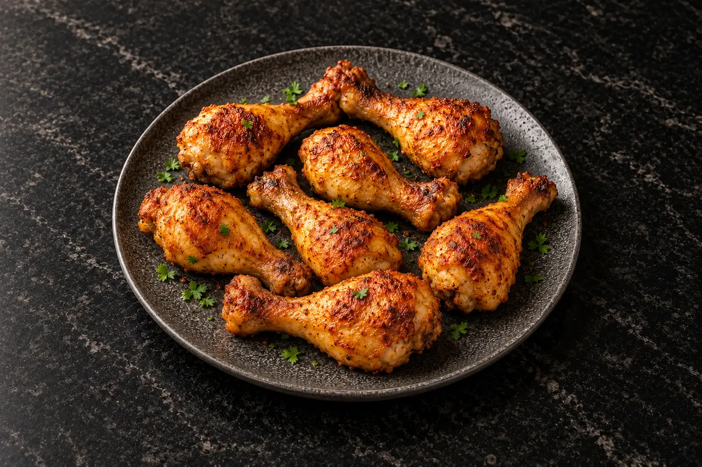

# AirRecipes Dark Kitchen — Signature Collection

Фірмовий стиль зображень загального каталогу AirRecipes. Це **еталон для майбутніх генерацій**, а не фотографічне підтвердження результату приготування.

## Незмінні ознаки

- **Стіл:** чорний матовий граніт із тонкими природними сірими прожилками, без дзеркальних відблисків.
- **Посуд:** графітова кераміка або кам'яна фактура, без логотипів і написів.
- **Форма посуду змінюється відповідно до їжі:** плоска кругла тарілка для м'яса й овочів; глибока тарілка для пасти та рагу; миска для супів; овальне блюдо для великих порцій.
- **Світло:** тепле м'яке розсіяне зліва, природні тіні справа. Страва добре освітлена, фон темніший.
- **Камера:** приблизно 45° зверху, горизонтальний кадр 3:2; повністю видно посуд, навколо є вільний простір.
- **Декор:** мінімум, лише доречні до рецепта спеції або зелень.
- **Страва:** саме та їжа, що в рецепті, з правдоподібними формою, порцією, текстурою й прожарюванням.
- **Заборонено:** текст, водяні знаки, чужі логотипи, декоративні об'єкти, що відволікають, надмірний блиск, пластикова текстура, дерев'яна дошка замість посуду.

## Шаблон запиту для нового рецепта

> Original photorealistic professional food editorial image for **AirRecipes Dark Kitchen — Signature Collection**. [Назва страви й точний вигляд]. On a [flat / deep / oval] graphite-textured ceramic dish on a matte black granite countertop with subtle grey mineral veining. Warm soft diffused directional lighting from the left, gentle shadows, appetizing realistic texture. Shot from around 45 degrees slightly overhead, landscape 3:2, whole dish visible with comfortable dark negative space. Minimal appropriate garnish. Visually consistent with the AirRecipes chicken drumsticks reference. No text, no logos, no watermark, no wooden board, no unrealistic food details.

## Робочий процес

1. Згенерувати зображення, використовуючи цей опис і еталон.
2. Перевірити відповідність страві, кількість/форму продуктів, відсутність зайвих деталей.
3. Експортувати в WebP (рекомендовано ширина 1280 px, якість приблизно 80–85) для економії трафіку.
4. Зберегти фото під постійним англомовним slug у `images/`; для заміни використовувати нову версію імені або URL, щоб уникнути застарілого кешу.
5. Вказати в записі каталогу походження ілюстрації, якщо вона згенерована ШІ. Не ставити статус «Перевірено» тільки через наявність зображення.

Різні генерації можуть трохи відрізнятися: для максимальної схожості використовуйте еталонне фото як стилістичний референс і перевіряйте результат вручну.
